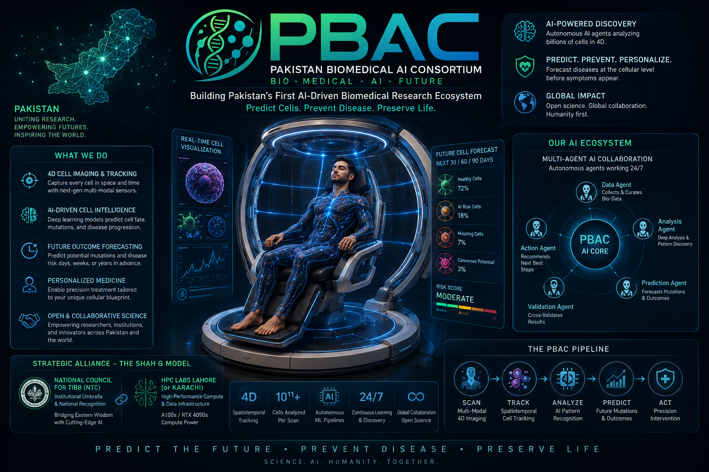

# Pakistan Biomedical AI Consortium (PBAC)



> **Building Pakistan's First AI-Driven Biomedical Research Consortium**

---

# Vision

To establish Pakistan's first independent AI-driven biomedical research consortium by integrating artificial intelligence, computational biology, high-performance computing, and interdisciplinary scientific collaboration.

---

# Mission

PBAC aims to develop reproducible, open, and globally competitive biomedical AI systems capable of advancing disease prediction, cellular intelligence, precision medicine, and computational healthcare.

---

# Flagship Project

## PBAC Intelligent Cellular Scanner

A next-generation AI-assisted whole-body cellular intelligence platform capable of:

- AI-assisted cellular mapping
- Whole-body digital cell tracking
- Mutation risk prediction
- Disease progression forecasting
- Precision medicine recommendations
- Biomedical digital twin generation

---

# Current Research

- BioHub Cell Tracking
- AI Medical Imaging
- Computational Biology
- Predictive Cellular Intelligence
- High Performance Computing (HPC)

---

# Repository Structure

```
docs/
├── Master-Concept-Paper.md
├── Research-Notes.md
├── Roadmap.md
├── Architecture.md
├── Team-Structure.md
├── Collaboration-Framework.md
├── MoU.md
├── proposals/
├── governance/
├── kaggle/
└── assets/
```

---

# Long-Term Vision

Building Pakistan's first internationally recognized Biomedical AI ecosystem connecting researchers, physicians, AI engineers, computational biologists and HPC laboratories.

---

# Status

**Project Status:** Early Research & Strategic Planning

---

# License

Copyright © Pakistan Biomedical AI Consortium (PBAC)

All Rights Reserved.
